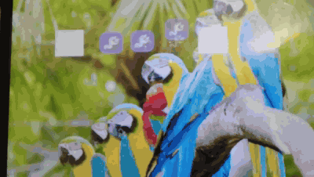
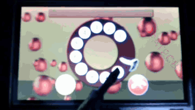
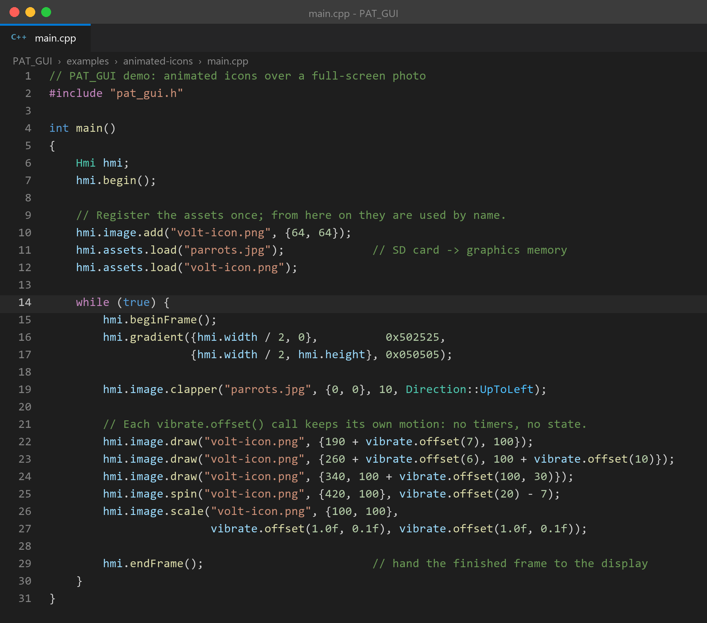
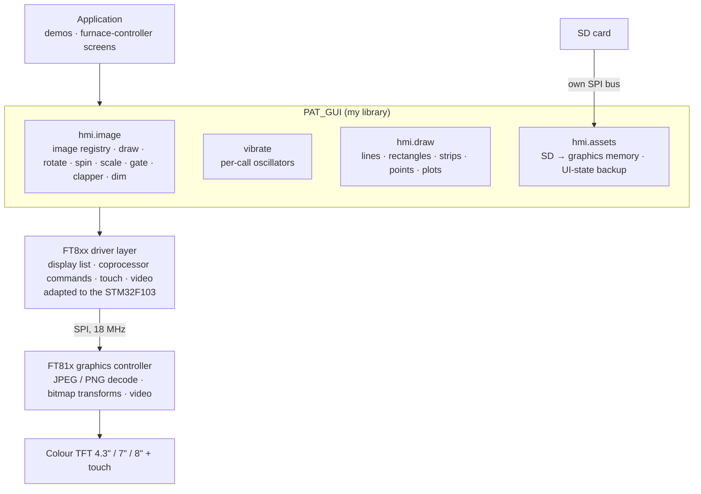
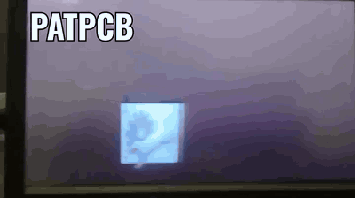
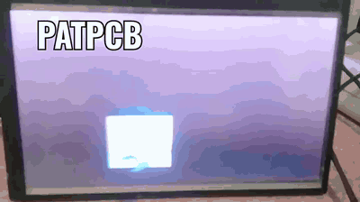
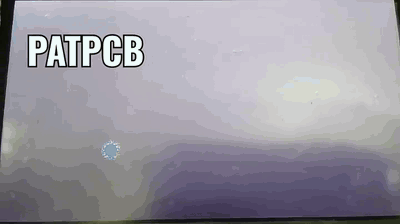
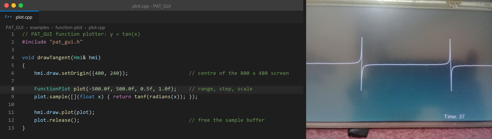
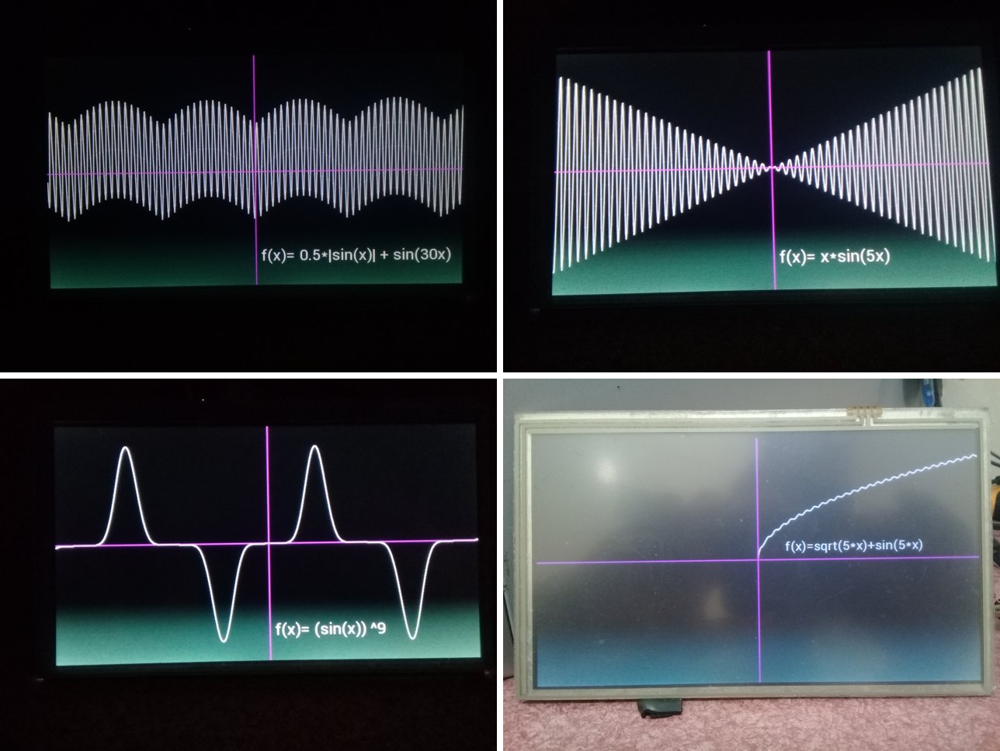

# Embedded Graphics & Video Engine

**PAT_GUI: a high-level graphics, animation and video library for STM32F1 (Cortex-M3) touch displays**
Freelance project, 2018 · designed and written by Pourya Afshintabar · sold to a client

  
  

<h2 align="center">All of this runs on a single STM32F1 at just 72 MHz</h2>

<b>One Cortex-M3 with no graphics hardware of its own drives every animation, transition, plot and video on this page.</b>

> In 2018, a smooth graphical interface on a small microcontroller meant writing the drawing, image handling and animation code by hand for every screen; the GUI builders and code generators that are common today were not available for this class of device. I wrote **PAT_GUI** so that an embedded developer can show an image, run a transition, animate an icon, plot a mathematical function or play a video **with one function call**, and leave the low-level work to the library.

---

## At a glance

| | |
|---|---|
| **Host MCU** | **STM32F103 (ARM Cortex-M3) at 72 MHz**, the clock the demos run at; an optional 128 MHz overclocked profile is also available |
| **Graphics controller** | FTDI/Bridgetek FT81x (EVE), 800 × 480 panel timing; FT80x also supported |
| **Displays** | Colour TFTs with touch: 4.3", 7" and 8" |
| **Storage** | SD card on its own SPI bus: images, video and saved UI state |
| **Library** | PAT_GUI, C++: image registry, transitions, rotation and scaling, procedural animation, drawing primitives, function plotting, touch, video |
| **Platform** | "PAT HMI": the board, a board-support package with panel selection, and numbered example libraries |
| **Toolchains** | Its own board-support package for the IDE, plus Keil MDK and IAR EWARM |
| **Outcome** | Sold as a library to a private client; also used for the touch interface of an industrial furnace controller |

---

## The idea: one call per graphical operation

A complete animated screen takes a few lines. This program produces the animation at the top of this page: a full-screen photo, a gradient, and icons that shake, bounce, spin and pulse.

The assets are registered and loaded once; after that the code refers to them only by file name. Each `vibrate.offset()` call keeps its own motion, so the loop has no variables, timers or animation state of its own. `hmi.beginFrame()` and `hmi.endFrame()` frame the drawing calls, and `endFrame()` hands the finished frame to the graphics controller in one step.

---

## Architecture

- **Driver layer.** A C++ driver for the FT80x/FT81x controllers in the style of the open-source Gameduino 2 driver, adapted to the STM32F103: the display list, the coprocessor commands (gradients, text, buttons, gauges, sliders, keyboards), touch input and the video commands, with the panel timing and touch calibration of the boards.
- **PAT_GUI layer.** My own library on top of the driver. It turns groups of low-level commands into single calls, and it keeps the state that animations need, so the application does not have to.
- **Frame model.** Every frame is described between `beginFrame()` and `endFrame()`; the finished frame reaches the screen in one step, so animations run without flicker or half-drawn frames, although the STM32F1 has no graphics hardware of its own.

---

## Verified capabilities

Everything below is taken from the library's source code, its demo programs, and the photos and videos of the running boards.

### 1. An image registry: images addressed by name

`hmi.image.add(name, size)` registers an image; `hmi.assets.load(name)` assigns it a bitmap handle, opens the file on the SD card and streams it to the graphics controller, which decodes the JPEG or PNG into its own memory. From then on, `hmi.image.draw(name, position)` draws it. The registry holds up to 20 images, and the application never handles memory addresses, handles or image formats.

### 2. Transitions built on the bitmap transform matrix

`hmi.image.gate(...)` and `hmi.image.clapper(...)` set single coefficients of the controller's bitmap transform matrix: `gate` scales the image along one axis (horizontal or vertical), and `clapper` shears it (`Direction::UpToLeft` or `Direction::UpToRight`). The effect amount (1–90) goes through a quartic curve, so the motion starts slowly and speeds up, like a door or a clapperboard.

| Gate open & close | Sliding gate |
|:---:|:---:|
|  |  |

### 3. Rotation and scaling around the image centre

`rotate`, `spin`, `hold` and `scale` each build the coprocessor transform in one call: translate to the image centre, scale, rotate, translate back. The library remembers every image's angle and scale. `hmi.image.spin(name, position, step)` adds the step to the stored angle every frame, so one line in the loop spins an image continuously, and `hold(name)` keeps it at its current angle. Drawing state is saved and restored around every transformed image, so effects never leak into the next object.

### 4. Procedural animation without timers: `vibrate`

`vibrate.offset(range, speed)` returns a value that moves back and forth between −range and +range by `speed` each frame (3 by default). Each call in a frame gets its own oscillator, by the order of the calls, and `endFrame()` resets the order for the next frame. Used as a coordinate it shakes or bounces an object, as a spin step it turns it back and forth, and as a scale factor it makes it pulse.

### 5. Drawing primitives

`hmi.draw` wraps the primitives the screens need: lines, outlined and filled rectangles, a filled rectangle with its own outline and two transparency levels, filled edge strips of 4 to 7 points with an outline, and points of any size. A small 2-D vector type adds polar moves, angle-to and distance tests for moving objects. `hmi.image.dim(alpha)` darkens the screen or a region with a transparent overlay.

### 6. Mathematical function plotting

A later version of the library (late 2018) added a function plotter. The formula is an ordinary C++ expression in `x`:

The photos show it plotting `x²`, `tan(x)`, `x·sin(x)`, `x·sin(5x)`, `√(5x) + sin(5x)`, `sin(x) + 0.1·sin(30x)`, `0.5·|sin(x)| + sin(30x)` and `sin⁹(x)`.

### 7. Touch interfaces

Touch coordinates and touch tags from the controller are available to the application. The rotary telephone dialer on the 4.3" panel (top of this page) follows the stylus around the dial, and each dialled digit appears in the number field.

### 8. Video playback

The driver layer includes the FT81x video commands and media FIFO, and the demo board plays full-motion video on the 8" panel after a scrolling text introduction.

### 9. SD-card streaming and state backup

Files are read from the SD card in 8 KB blocks and sent to the graphics controller in 2 KB, 32-bit-aligned chunks, with an optional progress callback. The asset manager also saves the interface state (current screen and data buffers) to the SD card in **two backup slots** and, at start-up, restores from slot 1 or, if that fails, from slot 2.

### 10. A complete HMI platform

- **Board-support package:** one menu selects the panel type (for example the 7" LCD), the upload method (ST-Link), code-size optimisation and the core clock: 72 MHz (recommended) or 128 MHz (overclocked).
- **Numbered example libraries** for the board, from GPIO, timers and external interrupts to modules such as a thermocouple interface and a 16 × 2 character LCD.
- **Toolchains:** besides its own board-support package, the board could be programmed with Keil MDK or IAR EWARM.
- **In an industrial controller:** the same library drives the touch interface of an industrial furnace controller, with home and settings screens, an on-screen keyboard, a graph view, a progress view and a time–temperature program list.

---

## Engineering highlights

- **Smooth graphics on a 72 MHz microcontroller.** The STM32F1 only describes each frame and streams assets; decoding, transforms and drawing run on the graphics controller, so a 72 MHz Cortex-M3 drives full-screen animation and video.
- **Animation state hidden behind a plain value.** `vibrate` keeps one oscillator per call site and resets at the end of each frame, so animated screens are written like static ones.
- **Effects from first principles.** Gate and clapperboard transitions come from individual coefficients of the bitmap transform matrix with a quartic easing curve, not from pre-rendered frames.
- **Stateful image objects on a stateless display list.** Each image remembers its position, angle and scale between frames, which turns `spin` and `hold` into one-line controls.
- **Assets by name.** File name → bitmap handle → graphics memory, with the JPEG/PNG decoding done by the controller while the file streams from the SD card.
- **Robust state handling.** UI state is saved to two SD-card slots with automatic fallback at start-up.
- **A platform, not only a library:** board-support package with panel selection and clock profiles, example libraries, standard ARM toolchains, and use in an industrial controller.
- **A product:** the library was sold to a client.

---

## A note on names

The examples on this page use cleaned-up, modern C++ names. The 2018 source used these names:

| On this page | In the 2018 source |
|---|---|
| `hmi.beginFrame()` / `hmi.endFrame()` | `HMI.Clear(1, 1, 1)` / `HMI.swap()` |
| `hmi.gradient(...)`, `hmi.width`, `hmi.height` | `HMI.cmd_gradient(...)`, `HMI.h`, `HMI.w` |
| `hmi.image.add(name, size)` | `HMI.Image.saveDetails(w, h, name)` |
| `hmi.assets.load(name)` | `RAMi.loadImage(name)` |
| `hmi.image.draw(name, position)` | `HMI.Image.show(x, y, name)` |
| `hmi.image.spin(...)` / `hold(...)` | `HMI.Image.rotatePlay(...)` / `rotatePause(...)` |
| `hmi.image.gate(...)` / `clapper(...)`, `Direction::UpToLeft` | `HMI.Image.gate(...)` / `claper(...)`, `UP2LEFT` |
| `hmi.image.dim(alpha)` | `HMI.Image.blur(alpha)` |
| `vibrate.offset(range, speed)` | `Vibrate.h(range, speed)` |
| `hmi.draw` | `HMI.Drow` |
| `FunctionPlot`, `plot.sample(...)`, `hmi.draw.plot(...)`, `plot.release()` | `algorithm`, `algorithm_formula(...)`, `HMI.Drow.shape(...)`, `fx.free()` |

---

## About this repository

The library was sold to a client, so its **source code is not published**. This repository documents the work through the original demo videos and photos; the descriptions of the internals come from the original source.

**Contact:** [pat.embedded@gmail.com](mailto:pat.embedded@gmail.com) · [LinkedIn](https://www.linkedin.com/in/pourya-afshintabar/)

© 2026 Pourya Afshintabar. All rights reserved. View-only; see [LICENSE](LICENSE).
